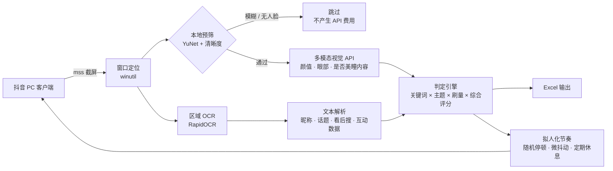

# 抖音美瞳达人筛选自动化工作流

> 面向美瞳投放场景的桌面端达人筛选工具：把「人工刷推荐流、逐条看人、手抄数据」变成一条自动流水线。

电脑端抖音客户端的**颜值达人筛选助手**：慢速拟人刷视频 → AI 视觉判断达人眼部条件/颜值 →
识别话题标签与看后搜词条 → 过滤刷量号 → 自动写入 Excel。

**它只做三件事：读画面、做判断、记数据。**
不做：自动评论、自动私信、自动关注、自动分享。

---

## 项目概览

**业务背景**：美瞳投放需要大量「眼部条件好、上镜、能拍眼妆特写」的达人。人工筛选时，一个人一天最多看几百条，而且判断标准会漂移。

**解决思路**：模拟真人节奏浏览推荐流 → 本地 OpenCV 先做廉价预筛 → 多模态视觉模型只对候选画面做判断 → 用 OCR 识别的话题标签 / 看后搜词条做关键词匹配 → 用点赞率与评论重复度剔除刷量号 → 结果落 Excel。

| 维度 | 说明 |
|---|---|
| 语言 / 环境 | Python 3.10+，Windows 桌面 |
| 界面 | PySide6（Qt Widgets），深色控制台 + 实时画面预览 |
| 视觉理解 | OpenAI 兼容多模态 API（DeepSeek `deepseek-flash` / qwen-vl-max，可切换） |
| 本地视觉 | OpenCV + YuNet 人脸检测（预筛、眼部区域清晰度） |
| 文字识别 | RapidOCR（ONNX Runtime），按屏幕区域分别裁剪与放大 |
| 桌面自动化 | mss 截屏 + pyautogui 键鼠模拟 + Win32 API 窗口管理 |
| 数据输出 | openpyxl 生成 Excel |

### 数据流



### 几个工程上的取舍

1. **成本控制：两级视觉流水线**
   每条视频都调多模态 API 成本很高。先用本地 YuNet 预筛，但只拦「整体模糊」这类明确无效的画面，人脸判断交给 AI —— 本地检测对侧脸、远景、剧情镜头的漏检率太高，拦得太狠会让 AI 根本没机会看。阈值做成 `strict` 开关，在「省钱」和「别误杀」之间可调。

2. **防风控：把操作节奏参数化**
   停留时长、滚动档数、动作间隔、休息频率全部是随机区间；一次滚动拆成多段，模拟真实滚轮的顿挫感；连续 N 次画面不变即判定「滑动失效」并换策略重试，而不是无脑重复同一个动作。

3. **配置热加载**
   `config.yaml`、关键词库、水军话术库都做 mtime 检测，运行中改完下一轮即生效 —— 调阈值不用重启，也不用中断正在跑的任务。

4. **降级不中断，且标注来源**
   API 不可用时退回本地启发式（只能判断「眼睛是否看得清」，判断不了颜值），并在结果里标注数据来源，避免把降级结果误当成 AI 结论。

5. **OCR 分区而不是整图**
   抖音 PC 端的昵称、互动数据、话题标签分布在不同区域、字号差异大。按区域分别裁剪并设置不同放大倍数，准确率和速度都优于整图识别。

---

## 一、先看清楚能力边界（很重要，避免踩坑）

| 项目 | 实际情况 | 本工作流的处理方式 |
|---|---|---|
| **播放量** | 抖音 PC 推荐流**不显示**别人的播放量 | 读到就用来算点赞率；读不到时，「点赞率」这一列留空，并在判定理由里注明口径。可用 `play_count_mode: manual` 手动填一个播放量基准来统一估算 |
| **视频真实链接** | 桌面客户端推荐流拿不到 URL | 默认生成**抖音搜索链接**（点开就是该达人），方便你人工定位；`output.link_mode` 可改成 `empty` 留空 |
| **达人主页链接** | 同上 | 同上（`link_mode` 也控制它） |
| **评论区** | 需要展开评论区才可见 | 评论区展开时才能做水军话术检测；未展开则该规则自动跳过 |
| **颜值/眼部判断** | 需要多模态模型 | 必须配 `vision.api_key`（默认走 DeepSeek `deepseek-flash`）。没配则降级为本地启发式（只能判断"眼睛是否看得清"，**判断不了颜值**） |

> 结论：**播放量和真实链接这两项，是抖音客户端本身不给，不是脚本能力不足。** 其余需求全部实现。

---

## 二、快速开始

### 1. 填配置（唯一必须做的一步）

仓库里的 `config.yaml` 是**脱敏模板**（Key 为空）。如果你是从 GitHub 克隆的，先复制一份：

```bash
copy config.example.yaml config.yaml      :: Windows
cp config.example.yaml config.yaml        # macOS / Linux
```

然后打开 `config.yaml`，填上 Key：

```yaml
vision:
  provider: "deepseek"
  base_url: "https://api.deepseek.com"
  api_key: ""                  # <<< 填这里；或用环境变量（推荐）
  model: "deepseek-flash"
  thinking: false              # DeepSeek 思考模式默认开启，关掉更快更省 token
```

> **不要把 Key 提交到仓库。** 更安全的做法是用环境变量，代码会优先读取它：
> `set VISION_API_KEY=sk-xxx`（Windows）/ `export VISION_API_KEY=sk-xxx`（macOS · Linux）

支持任何 **OpenAI 兼容**的多模态接口。界面上的「视觉服务商」下拉可以直接切换，会自动帮你改好 base_url 和 model：

| 服务 | base_url | model | 备注 |
|---|---|---|---|
| **DeepSeek（推荐）** | `https://api.deepseek.com` | `deepseek-flash` | 便宜、支持图片。注意 `deepseek-v4-pro` **不支持**图片输入 |
| 阿里通义千问 | `https://dashscope.aliyuncs.com/compatible-mode/v1` | `qwen-vl-max` | 细节识别更强，价格更高 |
| 智谱 GLM | `https://open.bigmodel.cn/api/paas/v4` | `glm-4v-plus` | |
| 火山豆包 | `https://ark.cn-beijing.volces.com/api/v3` | 你的视觉接入点 ID | |
| OpenAI | `https://api.openai.com/v1` | `gpt-4o` | 需网络可达 |

> DeepSeek Key 申请：**platform.deepseek.com → API Keys**。
> 填进 `vision.api_key`，或直接在控制台的「视觉 API Key」输入框里粘贴 → 点「保存」→ 点「测试」。
> 如果报 401，先确认 Key 和「视觉服务商」是同一家（DeepSeek 的 Key 配阿里云的地址必然失败）。

### 2. 关键词库（已经帮你预填好了）

`keywords.txt` **已预填约 90 个美瞳相关词**，按六类分好组，开箱即用：

- **通用品类词**：美瞳、彩瞳、彩色隐形眼镜、瞳片…
- **国际大牌**：强生安视优、博士伦、爱尔康、库博、绮芙莉、晶硕、海昌、海俪恩…
- **国货新锐**：moody、可啦啦、希多蜜、EYEPONY、YOUHOO、可糖、LENSPOP…
- **日系进口**：SEED、Envie、Loveil、T-Garden、LILMOON…
- **花色风格**：小直径、混血款、奶咖、摩卡、灰棕、雾面、小鹿眼…
- **抛期材质**：日抛、月抛、半年抛、硅水凝胶、非离子…

用法：
- 一行一个词，`#` 开头的行会被忽略；想停用某类词，行首加 `#` 即可
- **保存即生效，不用重启工作流**（控制台里也能直接编辑）
- **文件为空 → 不做关键词限制**，此时靠下面第 3 条的「美瞳内容自动识别」兜底
- 匹配范围默认 = 视频的「看后搜词条」+「话题标签」，可在 `keywords.match_scope` 调整

### 3. 美瞳内容自动识别（不填关键词也能用）

关键词库是你"告诉它该找什么"；这个功能是让 **AI 自己看出这条视频在卖美瞳**。

```yaml
theme_detect:
  enabled: true
  use_ai: true                 # AI 读画面里的文案/贴纸/字幕，判断是否美瞳相关
  counts_as_keyword_hit: true  # 识别出来 ≈ 命中了一个关键词
  reject_unrelated: true       # 不相关的视频直接跳过不记录（false = 全都记录，只做标注）
  words: [美瞳, 彩瞳, 隐形眼镜, 日抛, 硅水凝胶, ...]   # 本地兜底词表，扫文案+看后搜+话题
```

实际行为：
- 关键词库**为空**时 → 只有被判定为美瞳相关的视频才会写进 Excel（就是"看到卖美瞳的就记下来"）
- 关键词库**非空**时 → 关键词命中 或 美瞳内容命中，任一即可通过
- 万一 API 挂了 → 不会因为"识别不出美瞳"把所有视频卡掉，而是退回本地词表判断

界面上就是「美瞳内容自动识别」这个勾选框，取消勾选即恢复纯关键词模式。

### 4. 跑起来（推荐用可视化控制台）

```
双击 run.bat
```

会打开一个**可视化控制台窗口**（没有黑色命令行框），点「▶ 启动工作流」即可：

- 抖音客户端没开 → 自动启动；窗口最小化 / 缩托盘 → 自动还原到桌面
- 自动点「推荐」进入推荐流，开始逐条刷视频
- **左侧实时显示**正在识别的画面（边框颜色 = 判定等级）和结论卡片
- 右侧可以**直接改关键词库、点赞率阈值、自动点赞开关**，改完即生效
- 底部两个页签：运行日志 / 候选达人表格（双击行可打开达人搜索页）

控制台按钮说明：

| 按钮 | 作用 |
|---|---|
| ▶ 启动工作流 | 开始刷视频识别（会自动处理窗口） |
| ⏸ 暂停 / ▶ 继续 | 暂停时画面、鼠标、按键全部停止 |
| ⏹ 停止 | 安全收尾并保留统计 |
| 唤出窗口 | 手动把抖音窗口调到前台 |
| 切到推荐页 | 手动点击「推荐」频道 |
| 打开结果表 / 打开日志 | 直接打开对应文件 |

> 想用原来的黑框命令行版本：`run.bat --console`（支持 `--check` / `--once` / `--no-alert` 参数）。

**运行前请确保抖音客户端已经启动过一次并登录**（脚本也能自动拉起客户端）；窗口最小化或缩在托盘都会被自动还原。

---

## 三、参数速查

### 最常改的三个

```yaml
filter:
  like_rate_threshold: 0.02     # 点赞率阈值，随时改，实时生效
  like_floor: 50                # 点赞数下限

auto_like:
  enabled: false                # 自动点赞总开关，默认关闭
```

### 节奏控制（防风控）

```yaml
rhythm:
  dwell_seconds: [2, 5]     # 看完一条停多久（随机区间）
  scroll_steps: [2, 6]      # 每次下滑几档滚轮（随机）
  scroll_segments: [1, 3]   # 一次下滑拆成几小段，模仿真实滚轮的顿挫
  rest_every: [8, 15]       # 每刷 N 条休息一次
  rest_seconds: [30, 90]    # 每次休息多久
  mouse_jitter: true        # 滚动前轻微移动鼠标
```

节奏越慢越安全，但筛选效率越低。`2~5 秒 / 条` 是接近真人的速度。

### 刷量号规则

```yaml
filter:
  like_rate_enabled: true
  like_rate_threshold: 0.02        # 点赞率 < 2% → 判为刷量号
  play_count_mode: "auto"          # auto=读到播放量才用 / manual=用手动基准 / off=关掉这条规则
  manual_play_count: 0             # play_count_mode=manual 时的播放量基准

  like_floor_enabled: true
  like_floor: 50                   # 点赞量低于 50 且播放量高 → 刷量嫌疑
  like_floor_min_play: 10000

  comment_spam:
    enabled: true
    repeat_ratio: 0.4              # 重复评论占比超过 40% → 水军
    min_comments: 6                # 至少识别到 6 条评论才判定
```

水军话术库在 `spam_phrases.txt`，同样**保存即生效**，可以随时增删。

### 等级判定

```yaml
grade:
  high_match_score: 75    # 综合分 ≥ 75 → 高匹配
  normal_score: 45        # 综合分 ≥ 45 → 普通；低于则丢弃
  weights:
    vision: 0.50          # AI 视觉权重
    keyword: 0.35         # 关键词命中权重
    metrics: 0.15         # 数据健康度权重
```

综合分 = 视觉分 × 权重 + 关键词分 × 权重 + 数据健康度 × 权重（自动归一化）。

---

## 四、执行逻辑（判定顺序）

```
刷到一条视频
   │
   ├─ 1. 是广告 / 直播？ ────────────────→ 跳过
   │
   ├─ 2. AI 视觉：无真人 / 面部遮挡 / 眼睛看不清？ → 等级=不达标，跳过
   │
   ├─ 3. 关键词 / 美瞳内容（两道关，任一通过即进入下一步）
   │      ├─ 看后搜词条 或 话题标签 命中关键词库 → 通过
   │      ├─ 没命中 → 再看「美瞳内容识别」（AI 读画面 + 本地词表）
   │      │        命中且 counts_as_keyword_hit=true → 通过
   │      └─ 都没命中 → 等级=不达标，跳过
   │         （关键词库为空且 reject_unrelated=true 时，只有识别为美瞳相关才通过）
   │
   ├─ 4. 命中刷量规则？（点赞率 / 点赞量 / 评论水军）→ 等级=刷量号
   │
   ├─ 5. 算综合分 → 高匹配 / 普通
   │
   └─ 满足条件 → 写入 Excel，若自动点赞开关开启则点赞
```

---

## 五、Excel 输出

文件：`data\达人筛选结果.xlsx`（默认表名「候选达人」）

| 列 | 说明 |
|---|---|
| 序号 | 自增 |
| 视频链接 | 默认是抖音搜索链接（可点击） |
| 达人昵称 | OCR 识别 |
| 达人主页链接 | 同上 |
| 看后搜词条 | 「看后搜：xxx」里提取，带前缀的为确定值 |
| 话题标签 | `#xxx` 形式的标签，多个用空格分隔 |
| 命中关键词 | 命中了关键词库里的哪些词 |
| 判定理由 | 视觉理由 + 关键词理由 + 点赞率口径 |
| 播放量 | 读不到则为空 |
| 点赞数 / 评论数 | OCR 从右侧互动栏识别 |
| 点赞率 | 点赞 ÷ 播放；无播放量时留空 |
| 等级标记 | **高匹配**（红） / **普通**（黄） / **刷量号**（绿） / 不达标（灰） |
| 识别时间 | 时间戳 |
| 截图存档 | `data\frames\` 下的截图路径，方便你回看 |

> 刷量号是否写入表格由 `filter.record_spam_to_excel` 控制（默认写入，方便你复查）。
> 不达标的视频默认**不写表**（`filter.record_rejected_to_excel: false`），但会记进 JSONL 全量日志。

---

## 六、运行日志

```
logs\run_2026-10-12.log          详细运行日志（自动轮转）
logs\decisions_2026-10-12.jsonl  每一条视频的完整决策（含被过滤的）
```

JSONL 里每条记录包含：视觉判断明细、原始互动数据、点赞率及口径说明、命中/未命中原因、
刷量/拒绝原因、OCR 原文、各阶段耗时。**想知道某条视频为什么被筛掉，翻这个文件就行。**

控制台每条视频会输出一行，例如：

```
[# 12] 🟥 高匹配 | 小鹿美妆日记     | 眼部87分 | ❤1.8万/💬326 | 点赞率2.10%
        🏷 #美瞳 #妆容分享 #日抛  🔍 可啦啦月抛试戴  🎯 美瞳、可啦啦  分88.7
[# 13] ⬜ 不达标 | 未知达人         | 眼部0分 | ❤?/💬? | 点赞率N/A
        ⛔ 画面无真人出镜；面部被遮挡或不可见；眼睛看不清，无法判断美瞳佩戴效果
```

---

## 七、自动点赞（默认关闭，风险自负）

> ⚠️ **开启自动点赞会有抖音账号风控、限流、封号风险，风险由使用者自行承担。**

```yaml
auto_like:
  enabled: false                 # 总开关
  method: "template"             # template=模板匹配（准） / coord=相对坐标（简单）
  relative_xy: [0.918, 0.472]    # coord 模式：点赞按钮中心的相对位置
  delay_after_like: [3, 6]       # 点赞后随机等 3~6 秒再下滑
  max_likes_per_run: 30          # 单次运行最多点几个赞（防失控）
  like_cooldown: [8, 20]         # 两次点赞之间至少隔几秒
```

**推荐用模板匹配**：把点赞（心形）图标的截图存成
`templates\like_normal.png`，脚本会在画面右侧 30% 区域内自动找它。
没放模板图时会自动退回相对坐标模式。

怎么找 `relative_xy`：运行 `tools\tune_regions.py`，它会输出一张带 10% 网格的窗口截图，
数一下点赞图标中心的格子位置即可。

**正确做法：** 先跑几天、确认账号没问题，再考虑开启；并且 `max_likes_per_run` 不要设大。

---

## 八、按你的客户端微调 OCR 区域

抖音客户端不同版本的界面布局有差异，脚本靠相对坐标裁区域做 OCR。如果发现识别不准：

```bat
<项目自带python> tools\tune_regions.py
```

它会截取当前抖音窗口，画出各区域框 + 10% 网格，输出到 `data\preview\tune_regions.jpg`。
照着这张图调整 `config.yaml` 的 `ocr.regions` 即可（数值是 0~1 的相对比例）。

```yaml
ocr:
  regions:
    full:      [0.0, 0.0, 1.0, 1.0]     # 全画面（兜底）
    caption:   [0.04, 0.62, 0.72, 0.94] # 达人昵称下方：文案 + 话题标签 + 看后搜
    rail:      [0.78, 0.32, 1.0, 0.96]  # 右侧互动数据栏
    profile:   [0.0, 0.0, 0.55, 0.16]   # 左上角达人昵称
    comments:  [0.62, 0.20, 1.0, 0.95]  # 评论区（展开时有效）
  upscale_by_region:                     # 小字区域放大，识别率更高；大图不放大，省时间
    full: 1.0
    caption: 2.0
    rail: 2.2
```

---

## 九、离线自检

不刷抖音也能验证整条链路是否正常：

```bat
<项目自带python> tools\selfcheck.py
```

依次检查：依赖 → 窗口定位 → 截屏 → 真实画面 OCR → 解析/判定/写表。
全程不会滑动、不会点击、不会修改抖音上的任何东西。

---

## 十、目录结构

```
douyin_screener\
├─ run.bat                 一键启动
├─ main.py                 主程序
├─ config.yaml             主配置（热更新）
├─ keywords.txt            关键词库（热更新）
├─ spam_phrases.txt        水军话术库（热更新）
├─ requirements.txt        依赖清单
├─ models\                 YuNet 人脸检测模型
├─ templates\              点赞按钮模板图（可选）
├─ src\
│   ├─ config.py           配置热加载
│   ├─ winutil.py          窗口定位 / 截屏 / 弹窗
│   ├─ ocr.py              文字识别
│   ├─ vision.py           AI 视觉（多模态API + 本地降级）
│   ├─ parser.py           标签/看后搜/昵称/数据 解析
│   ├─ judge.py            关键词匹配 + 刷量判定 + 等级评分
│   ├─ excel_out.py        Excel 输出
│   ├─ human.py            拟人化滚动 / 自动点赞
│   └─ logsetup.py         日志
├─ tools\
│   ├─ selfcheck.py        离线自检
│   └─ tune_regions.py     OCR 区域标定
├─ data\
│   ├─ 达人筛选结果.xlsx    输出表格
│   ├─ frames\             命中视频截图
│   └─ preview\            调参预览图
└─ logs\                   运行日志
```

---

## 十一、常见问题

**Q：提示"没有找到抖音客户端窗口"**
看弹窗里的诊断信息：
- 说「窗口都被隐藏了」→ 客户端缩在托盘，点托盘图标调出来；或确认 `window.auto_restore_hidden: true`
- 说「没有检测到进程」→ 客户端根本没启动。默认会**自动启动**（`window.launch_if_not_running: true`），
  启动后如果主窗口不自动弹出（该客户端常驻托盘），脚本会自动去任务栏/托盘点抖音图标唤出
- 以上都失败 → 客户端可能处于更新中断的损坏状态，双击项目里的 **`修复抖音客户端.bat`**（UAC 点"是"），
  或到抖音官网重新下载安装
- 窗口标题不是 `douyin` 的版本 → 在 `window.process_name` 里改成实际的进程名

**Q：想每次启动后自动进入推荐页**
默认已开启：`window.auto_switch_feed: true`，启动后自动点击「推荐」。
如果客户端改版找不到入口，改 `window.feed_tab: ["推荐", "精选"]` 依次尝试。

**Q：我不想让刷量号/不达标视频出现在任何记录里**
默认就是这样：`filter.record_spam_to_excel: false`、`record_rejected_to_excel: false`、
`output.save_full_log: false` —— 只有合格视频会写入 Excel，截图和 JSONL 日志也只记合格视频。

**Q：一条视频要处理多久？**
OCR 约 1~4 秒 + 视觉 API 约 3~10 秒 + 随机停顿 2~5 秒。整体比真人刷得慢，这是刻意的。

**Q：识别到的话题标签/数据不准**
用 `tools\tune_regions.py` 微调 `ocr.regions`。`upscale_by_region` 调大也能提升小字识别率。

**Q：点赞率一直是空的**
抖音推荐流不显示播放量，正常。想强制计算就把 `play_count_mode` 改成 `manual`
并填一个 `manual_play_count`（按你对这类达人的播放量预期填）。

**Q：能不能边干别的边跑？**
不能。滚轮事件需要窗口在前台。`window.keep_foreground: true` 会每轮把窗口拉到前台。

**Q：怎么立刻停下？**
- 按 `Ctrl+C`
- 或者把鼠标**快速甩到屏幕左上角 (0,0)** —— pyautogui 的紧急制动，脚本会立即中断

---

## 十二、防风控设计说明

1. 所有时间间隔都是**随机区间**，没有固定频率
2. 一次下滑拆成 1~3 个小步滚动，模仿真实滚轮的顿挫感
3. 滚动前鼠标会轻微随机移动，不会长时间悬停在同一点
4. 每 8~15 条强制休息 30~90 秒
5. 自动点赞之间有 8~20 秒冷却，且有单次运行上限
6. 画面长时间不变（滑动失效）时才重试，不会连续猛刷

节奏参数都在 `rhythm` 段，觉得太激进了就调大区间。

---

## 十三、重新安装依赖（换电脑 / 环境损坏时）

```bash
python -m venv .venv
.venv\Scripts\pip install -r requirements.txt     # Windows
# source .venv/bin/activate && pip install -r requirements.txt   # macOS / Linux
```

如果 `rapidocr` 装不上，脚本会自动降级为「用多模态模型读画面文字」，
功能不受影响，只是会慢一些、API 花费高一些。

`run.bat` 会优先使用项目内的 `.venv`，其次是系统 PATH 里的 `python`。

---

## 免责声明

本项目用于个人学习与自动化流程的工程实践。默认配置刻意做了限速（2~5 秒/条、定期休息），
目的是尽量接近真人的使用节奏，而不是高频刷取。

使用者应自行遵守抖音的用户协议与相关法律法规，不要用于批量刷量、广告骚扰或破坏平台生态的行为。
自动点赞默认关闭，开启后可能触发平台风控，风险由使用者自行承担。

仓库内不含任何账号凭据：`config.yaml` 已被 `.gitignore` 排除，请勿把 API Key 提交到公开仓库。
